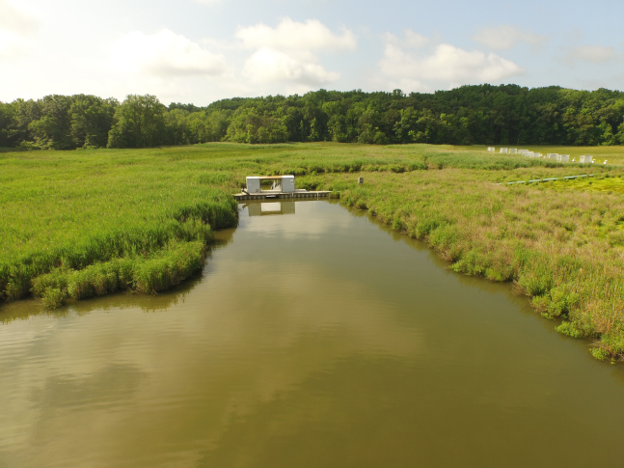
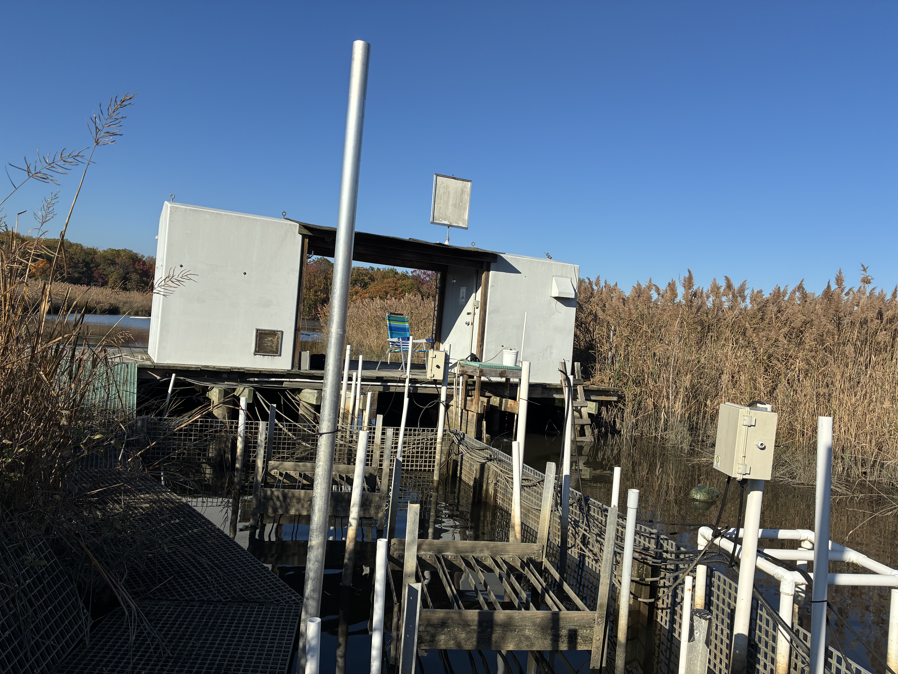
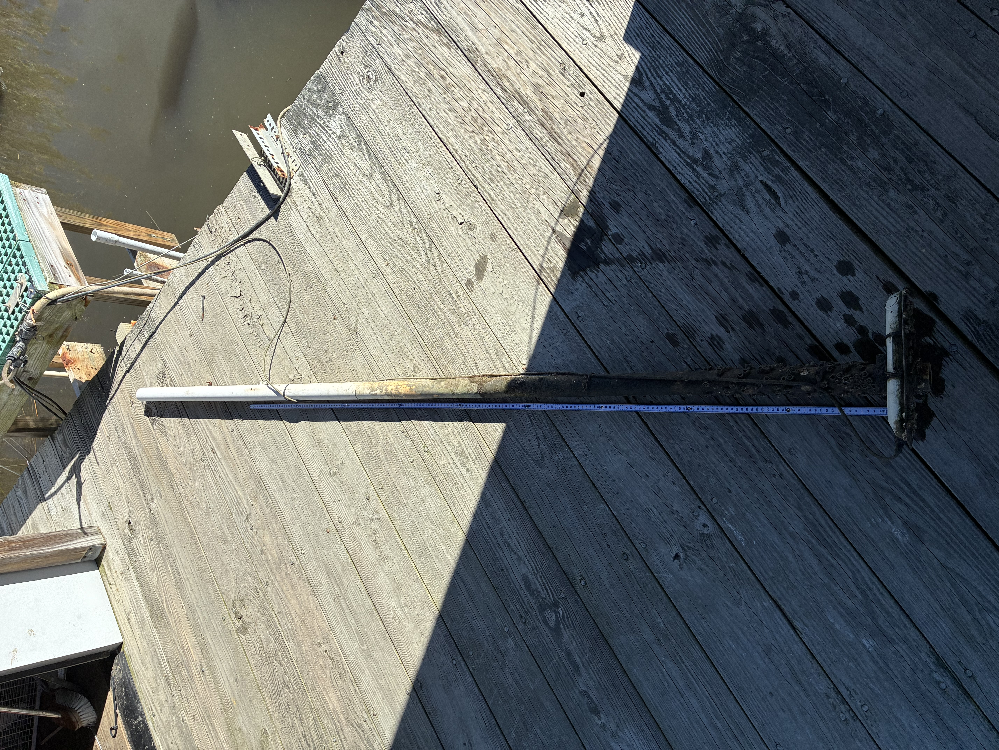

## Bathymetry Measurements: 

The height (z) from the sediment surface to the top of the boardwalk was measured every 25cm from the east side of the flume, across the tidal creek, to the other end (toward CO2 lab). We measured creek bathymetry along the flume front side (facing out to Rhode River) and back side (facing the organ). The flume opening is ~191.5cm wide. The Sontek IQ ADCP from sensors to bolt (176cm) and bolt to boardwalk (1cm) were also measured. Therefore, the height of tidal creek banks (63cm relative to the boardwalk) and the water depths measured by the Sontek IQ (ADCP) can be used to determine a depth at which overtopping would occur which would be ~112cm water heights.  

  
```{r setup, include=FALSE}

library(ggplot2)
library(ggpubr)

```


# Figures of tidal creek bathymetry, sontek location, flume width and overtopping height:   
```{r, echo=FALSE, message= FALSE, warning=FALSE }


## Read in Data
dat <- read.csv("GCReW_Flume_BathymetrySurvey_Data_20261029.csv")

#head(dat)

#Flume highlight area 
flume_area_front <- data.frame(
  x = c(800, 825, 850, 875, 900, 925, 950, 975), 
  #y = c(-203, -208.5, -220, -225, -226, -226.5, -223, -220) actual depths 
  y = c(0, -208.5, -220, -225, -226, -226.5, -223, 0)
)

sontek <- data.frame(
  x = c(875), 
  y = c(-175)
)

#Plot the front of the flume (facing out to Rhode River)
front_bathy <- ggplot() + 
   geom_polygon( data = flume_area_front, 
                aes(x = x, y = y), 
                fill = "lightblue", 
                alpha = 0.3, 
                color = "lightblue", 
                linewidth = 0.8, 
                inherit.aes = FALSE) +
  geom_point(data = dat, aes(x = distance_front_cm, y=(-1 *height_to_bw_front_cm)), 
             color="cornsilk4", fill = "cornsilk4", size=2) + 
  geom_line(data = dat, aes(x = distance_front_cm, y=(-1 * height_to_bw_front_cm)),
            color="cornsilk4", linewidth=1) + 
  geom_hline(yintercept = 0, color="darkorange4", linewidth=1) + 
  geom_point(data = sontek, aes(x=x, y=y), 
             color = "darkslateblue", fill="darkslateblue", shape=24, size=4) + 
  geom_hline(yintercept = -63, color="deepskyblue4", linetype="dashed", linewidth=1) + 
  labs(title="GCReW Flume: Front side Bathymetry", 
        x="Distance (d) from far east side of flume (cm)", 
        y="Height (z) from sediment to top of boardwalk (cm)") +
  scale_x_continuous(limits=c(0,2225))+
  theme_classic() + 
  annotate("text", x = 60, y = 10, label="Boardwalk" , color="darkorange4", size =4) + 
  annotate("text", x = 890, y = -10, label = "Flume", color = "cadetblue4", size =4) +  
  annotate("text", x = 890, y = -25, label = "~190 cm", color = "cadetblue4", size =3) + 
  annotate("text", x = 1000, y = -170, label = "Sontek", color = "darkslateblue", size =4) + 
  annotate("text", x = 2100, y = -70, label = "Overopping height", color = "deepskyblue4", size =4) + 
  annotate("text", x = 2100, y = -85, label = "112 cm", color = "deepskyblue4", size =4)

front_bathy


#Flume highlight area 
flume_area_back <- data.frame(
  x = c(800, 825, 850, 875, 900, 925, 950, 975), 
  #y = c(-203, -213, -212, -206, -203, -204, -200, -194) actual depths 
  y = c(0, -213, -212, -206, -203, -204, -200, 0)
)

sontek <- data.frame(
  x = c(875), 
  y = c(-175)
)

#Plot the front of the flume (facing out to Rhode River)
back_bathy <- ggplot() + 
   geom_polygon( data = flume_area_back, 
                aes(x = x, y = y), 
                fill = "lightblue", 
                alpha = 0.3, 
                color = "lightblue", 
                linewidth = 0.8, 
                inherit.aes = FALSE) +
  geom_point(data = dat, aes(x = distance_back_cm, y=(-1 *height_to_bw_back_cm)), 
             color="cornsilk4", fill = "cornsilk4", size=2) + 
  geom_line(data = dat, aes(x = distance_back_cm, y=(-1 * height_to_bw_back_cm)),
            color="cornsilk4", linewidth=1) + 
  geom_hline(yintercept = 0, color="darkorange4", linewidth=1) + 
  geom_point(data = sontek, aes(x=x, y=y), 
             color = "darkslateblue", fill="darkslateblue", shape=24, size=4) + 
  geom_hline(yintercept = -63, color="deepskyblue4", linetype="dashed", linewidth=1) + 
  labs(title="GCreW Flume: Back side bathymetry", 
        x="Distance (d) from far east side of flume (cm)", 
        y="Height (z) from sediment to top of boardwalk (cm)") +
  scale_x_continuous(limits=c(0,2225))+
  theme_classic() + 
  annotate("text", x = 60, y = 10, label="Boardwalk" , color="darkorange4", size =4) + 
  annotate("text", x = 890, y = -10, label = "Flume", color = "cadetblue4", size =4) + 
  annotate("text", x = 890, y = -25, label = "~190 cm", color = "cadetblue4", size =3) + 
  annotate("text", x = 825, y = -165, label = "Sontek", color = "darkslateblue", size =4) + 
  annotate("text", x = 2100, y = -85, label = "Overopping height", color = "deepskyblue4", size =4) + 
  annotate("text", x = 2100, y = -100, label = "112 cm", color = "deepskyblue4", size =4)

back_bathy


```

\newpage

{width=60%}  

{width=60%}    

