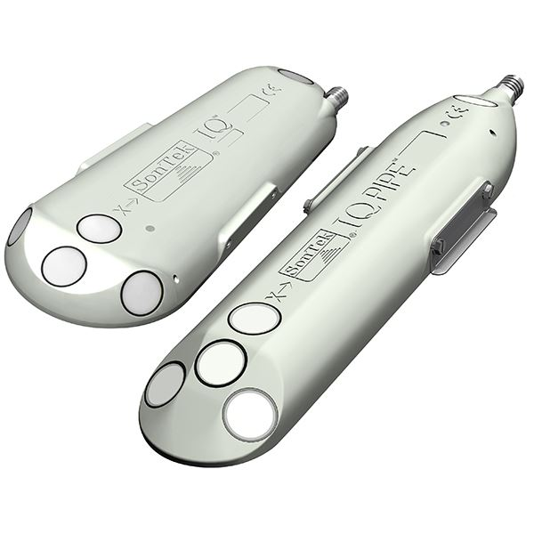
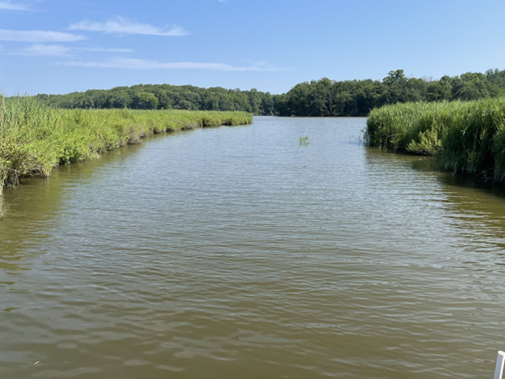

**GCReW - Flume Sontek ADCP Dataset** 

Data Type: Acoustic Doppler Current Profiler (ADCP) Tidal Creek Monitoring

Sampling Type: Continuous sensor

Sampling Locations: GCReW Flume (38.87486, -76.5465) 

 

Wilson S ; Miller W ; Noyce G ; Peresta D ; Read Z ; Reynolds A ; Rich R ; Megonigal J P (2026): Dataset: L2 2023-2025 Global Change Research Wetland (GCReW) Flume Sontek Acoustic Doppler Current Profiler (ADCP). FigShare repository. Dataset. doi: accessed via url.

 

**Data Description:** 
These data are measurements of water temperature, depth, velocity, and discharge made at the Smithsonian Environmental Research Center's Global Change Research Wetland (GCReW) in the Kirkpatrick Marsh along the Rhode River in Edgewater, MD, USA. Measurements were made  with a Sontek IQ series acoustic doupler current profiler (ADCP) at the GCReW Flume (38.87486, -76.5465) through which a tidal creek flows. The Sontek ADCP is affixed to a PVC pipe bolted to the center of the flume that extended to just above the sediment surface. Measurements were collected every six minutes and recorded by a Campbell Scientific CR1000x logger as described by Wilson et al. (in review).

Data collected every six minutes 2022-present. Previous data being prepared for repository publication by Whitman Miller and Amanda Reynolds. 

For questions about these data: contact Stephanie J. Wilson (wilsonsj@si.edu) or Patrick Megonigal (megonigalp@si.edu). 

 

**Data Processing:**
L0 Level Data: Raw data is received by the logger from the instrument. 

L1 level Data: L0 data is processed with programmatic quality checks and flags depth and velocity data when those data are out of the instrument bounds (OOR), out of service when the instrument is down for cleaning or servicing (OOS), and flagged for internal system status codes (SSF). L2 data have been visualized and flagged manually to identify data that is out of reasonalbe range (ORR).

L2 level Data: L1 water depth and index velocity measurements are manually QAQC'd and data are flagged as out of reasonable range (ORR) when applicable. Those data, along with any dependent data (cross sectional area, mean velocity, flowrate) are made to be NA when flagged as ORR or if they were flagged by L1 programmtic checks.  The only exception are SSF flags 2 and 3, which indicate a change in tilt values that were input into the ADCP and flag the user so that the IQ mount should be checked. Timepoints made to be NA are retained in the dataset along with their flags. Discharge, Q (m3/s), was calculated as the cross sectional area * velocity using both index velocity and mean velocity measured by the Sontek IQ and is reported here. The QAQC procedures are outlined and the code to produce these data from L0 are available on GitHub (link

 

**Data Files Available:** 

"L0_data" - All available L0 data combined into one parquet file 

"L1_data" - Annual files post L1 processing (2023-2025)

"L2_data" - Annual files post L2 processing (2023-2025)

"clean-sontek-files_L1.Rmd" - L1 processing file containing programmatic data flagging (takes L0 data to L1)

"clean-sontek-files_L2.Rmd" - L2 processing file containing Shiny out of reasonable range flagging application (takes L1 data to L2)

"clean-sontek-data-protocol.pdf" - PDF instructions for QAQCing sontek data 

  

